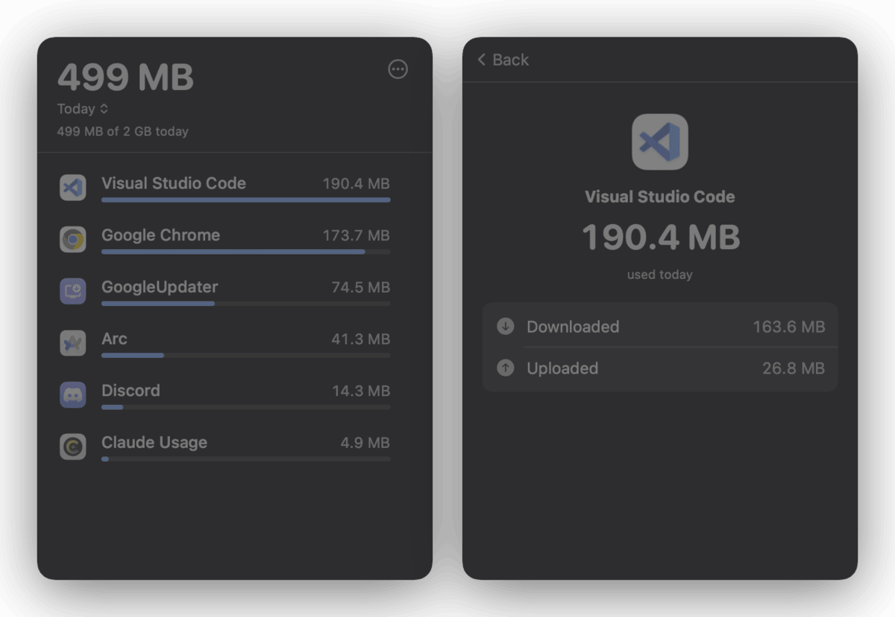

# Watchdog

Watchdog sits in your menu bar and shows which apps use your Wi-Fi data, right now and
over the day, week and month. Set a daily limit and get one alert when you reach it. It
warns you when you join a hotspot. Everything stays on your Mac. Open source, MIT.



## How monitoring works

Watchdog polls `nettop` (the built-in macOS network statistics tool) once a second and
parses its per-process, Wi-Fi-only output into per-app traffic figures. This needs
**no TCC prompts or system extensions** — it is read-only observation of what macOS
already reports — but the app runs with the **App Sandbox disabled** (required for
spawning `nettop` and resolving process paths via `proc_pidpath`; re-enabling the
sandbox silently breaks monitoring, and the app is not App Store-distributable).

- **Live monitor** shows usage since launch, updating every second; **Today / This week /
  This month** come from per-hour totals persisted in
  `~/Library/Application Support/Watchdog/usage.json`.
- Clicking an app shows its download/upload split and top remote hosts (this session).
- **Reports** charts usage as stacked bars per hour (Today) or per day (This week),
  with a peak summary and per-bucket app breakdown.
- An optional **daily data limit** shows progress in the header and posts at most one
  "limit reached" notification per calendar day.
- Hotspot (expensive) and Low Data Mode (constrained) networks are flagged with a
  header badge, with a notification when a hotspot connects.
- Helper processes (e.g. "Google Chrome Helper") are folded into their parent app via
  their executable path, so usage groups the way you'd expect.

## Build & run

Requires macOS 14 or later to run, and Xcode 26 or later to build.

Open `watchdog.xcodeproj` in Xcode and run the `watchdog` scheme, or:

```
xcodebuild -project watchdog.xcodeproj -scheme watchdog -configuration Debug build
```

## Current limitations

- **Monitoring only.** The app observes traffic; it has no blocking controls until the
  filter extension is wired up (see below).
- Polling `nettop` is sampled, not exact — connections that open and close entirely
  between two polls are missed, and byte counts are approximate.
- Wi-Fi interfaces only (`nettop -t wifi`), per the app's purpose; wired/VPN-only
  traffic is not counted.
- **Internet traffic only**: connections to private/LAN, link-local, and multicast
  addresses (mDNS, phone-to-Mac transfers, AirPlay…) are deliberately excluded.

## Blocking

An unwired scaffold for real traffic blocking (an `NEFilterDataProvider` content filter
system extension) lives in `WatchdogFilterExtension/`. It is intentionally **not** part
of any build target because it requires a paid Apple Developer team, extra entitlements,
and manual target setup in Xcode. See [BLOCKING.md](BLOCKING.md) for the exact steps
and why macOS requires all of that.

## Icon

The dog-with-eyeglasses logo is drawn in code: `Design/IconGen.swift`.
Regenerate with `swift Design/IconGen.swift color 1024 out.png` (app icon) or
`mono` (menubar template), then resize into `watchdog/Assets.xcassets`.

## Install

`xcodebuild -configuration Release build`, copy the built app to
/Applications. On first launch Watchdog registers itself as a login item
(toggle "Start at Login" in the ⋯ menu) and collects usage continuously;
history is kept for a year in hourly buckets.

## Privacy

All data stays on your Mac. Watchdog writes per-app totals to
`~/Library/Application Support/Watchdog/usage.json` and nothing else. It opens no network
connections of its own and has no analytics or crash reporting.

## License

MIT. See [LICENSE](LICENSE).
